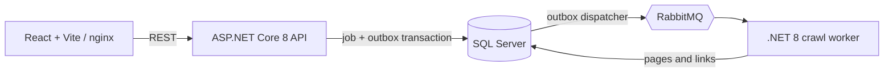

# URLScout — job-based web crawler

URLScout is a small full-stack crawler demo: submit a public URL, follow its same-origin links to a bounded depth, and inspect crawl progress, page results, and domain-link ratios.

## Run the full stack on Windows

Install Docker Desktop with Compose, then run these commands from the repository root in PowerShell:

```powershell
$env:MSSQL_SA_PASSWORD = Read-Host "Enter an 8+ character SQL password (upper/lower/digit/underscore)"
$env:RABBITMQ_PASSWORD = Read-Host "Enter a URL-safe RabbitMQ password (letters, digits, _ or -)"
docker compose up --build
```

Open the dashboard at <http://localhost:3000>. The API and Swagger UI are available at <http://localhost:5080> and <http://localhost:5080/swagger>; RabbitMQ management is at <http://localhost:15672> (user `crawler`, with the password supplied above).

Use the same passwords on subsequent starts while retaining the named SQL Server and RabbitMQ volumes. The RabbitMQ password is embedded in an AMQP URI, so enter URL-safe characters. Compose passes these credentials to containers; they are not committed to the repository. Use a secret manager for production, and do not expose this Compose stack to an untrusted network. Stop the containers with `Ctrl+C`; run `docker compose down` to stop them. Named SQL Server and RabbitMQ volumes keep data between starts.


## Architecture



- **API:** minimal REST endpoints for job creation, paginated history, job details, page-link lookup, cancellation, and SQL health.
- **Messaging:** a SQL-backed transactional outbox publishes durable RabbitMQ events; the worker uses manual acknowledgements and idempotent job claiming.
- **Crawler:** same-origin, bounded-depth breadth-first crawl; 25 pages/job, 250 links/page, 2 MB HTML/page, no redirect following, and public-address validation to avoid private-network targets.
- **Persistence:** EF Core 8 and SQL Server, with indexes for history, page deduplication, and link lookups. The demo bootstraps its schema at startup; production deployments should use versioned EF migrations.
- **Frontend:** React + TypeScript dashboard with live polling, job history, progress, expandable links, and responsive layout.
- **Operations:** structured .NET logs, API health endpoint, Docker Compose health checks, and GitHub Actions for backend tests and frontend lint/build.

The public-host check is defense in depth, not a complete network sandbox; production deployments should also enforce outbound network policy at the infrastructure layer.

## Develop, test, and inspect backend coverage (PowerShell)

The backend targets .NET 8. CI installs both the .NET 8 runtime and .NET 10 SDK: the test projects use xUnit v3/Microsoft.Testing.Platform, and the repository-level `global.json` opts `dotnet test` into the .NET 10 MTP runner.

```powershell
dotnet build .\backend\UrlCrawler.sln --configuration Release
dotnet test .\backend\UrlCrawler.sln --configuration Release --no-build
dotnet test .\backend\tests\UrlCrawler.Tests\UrlCrawler.Tests.csproj --collect:"XPlat Code Coverage"
Set-Location .\frontend
npm.cmd ci
npm.cmd run lint
npm.cmd run build
```

The coverage command writes a Coverlet Cobertura report under `backend/tests/UrlCrawler.Tests/TestResults`. In the latest run on 2026-11-09, all 76 backend tests passed; total line/branch coverage was **94.8% / 95.1%**. By project: API **94.0% / 96.7%**, Domain **99.0% / 94.4%**, Infrastructure **96.6% / 91.7%**, and Worker **93.1% / 96.1%**. `CrawlProcessor.cs` now has **100% line and branch coverage**. The build does not enforce 100% coverage; remaining gaps are in other worker code, API database startup retry/health-check exceptions, and outbox reconnect/confirm failures. See `backend/README.md` and the component READMEs for per-project guidance.

The frontend has lint and production-build checks but no unit-test or coverage script configured. For frontend hot reload, start the API and worker in separate terminals, then run `npm.cmd run dev` from `frontend`; Vite proxies `/api` and `/health` to `http://localhost:5080`. Add a frontend test/coverage runner if UI coverage is required.

## Repository layout

- `backend/UrlCrawler.sln` — .NET solution (Visual Studio `.sln` format).
- `backend/src/` — API, worker, domain, and infrastructure projects.
- `backend/tests/` — xUnit tests.
- `frontend/` — React + TypeScript application and nginx container configuration.
- `docker-compose.yml` — local SQL Server, RabbitMQ, API, worker, and frontend stack.
